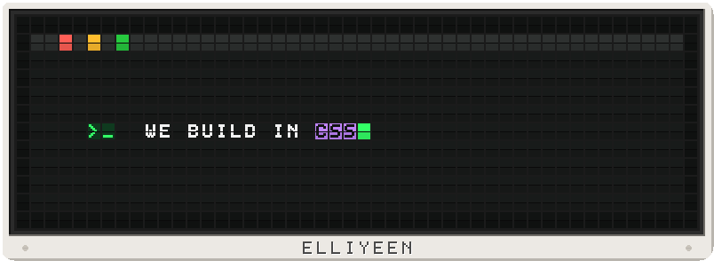
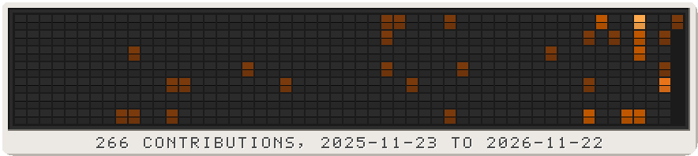

  <picture>
    <source media="(prefers-reduced-motion: reduce)" srcset="assets/splitflap-static.png">
    
  </picture>

# Forward Deployed AI Engineer | Enterprise Systems | Cybersecurity | Rust & TypeScript

**I turn complex business problems into secure, working software.**

Over 20 years of combined experience across military service, information technology, and super intelligence. Dallas, TX. Interested in remote forward-deployed roles.

[Website](https://www.elliyeen.com) · [**Work with me: send me a message on LinkedIn**](https://www.linkedin.com/in/abbasabdullah)

## How I work

Understand the customer problem → find the constraint → design → engineer → test independently → deploy → measure the outcome.

Every project below says how far it got along that line, and what is not proven.

## Flagship work

**[Screenwriter](docs/github-portfolio/case-studies/screenwriter.md)** · live product, private beta · [live app](https://write.elliyeen.com) · [public source (v0.6.3)](https://github.com/elliyeen/screenwriter) 
A private place to write screenplays, books and scripts in any browser, with exact page formats and print-ready export. Built from research into what writers complain about in existing tools. Rule-based, no AI model. Cloudflare Workers, D1, Durable Objects, R2. 27 unit checks pass on a fresh clone. No third-party security audit. No user figures published.

**[PayBlue](docs/github-portfolio/case-studies/payblue.md)** · concept and early prototype · [site](https://payblue.app) 
An idea to protect Texas benefit cards by moving the secret from the card to a protected identity on the phone. The front end and a Rust API skeleton exist. Sign-in, wallet, transactions and cryptography are **not built yet**. No live payments, and no approval, certification or endorsement by any government body is claimed. Source is private.

**[CLEARED benchmark](docs/github-portfolio/case-studies/cleared.md)** · benchmark on synthetic data · [source](https://github.com/elliyeen/cleared-public) 
A payment-authorization checker measured against a baseline, holdouts and automatic safety gates, with a regression reported and not hidden. Reproduces with a few commands. Deterministic code, no model, no customers or revenue.

## More work

- **[KAI × DART](docs/github-portfolio/case-studies/kai-dart.md)** · demonstration on synthetic data · [demo](https://elliyeen.github.io/kai-dart/platform) · [source](https://github.com/elliyeen/kai-dart). A station fix only counts when a different, independent inspector accepts the evidence. Not connected to live DART data, and not affiliated with or endorsed by DART.
- **[CAC/PIV authentication](docs/github-portfolio/case-studies/cac-piv.md)** · sanitized reference · [source](https://github.com/elliyeen/cac-piv-pki-authentication). Smart-card sign-in without trusting spoofable identity headers. 60 tests pass on a fresh clone. Synthetic certificates only; not a production system.
- **[Engineering factory](docs/github-portfolio/case-studies/engineering-factory.md)** · tested in a synthetic sandbox · [source](https://github.com/elliyeen/factory-sandbox). Gates that stop AI coding agents from approving or merging their own work. 12 of 14 certification tests pass; two are blocked, so it is **not certified**.
- **Ahead / Aliya** · live product, source private · [aheadjobs.com](https://aheadjobs.com). Matches companies and talent on evidence, with human approval and candidate consent before any introduction. Not inspectable here.
- **Static sites:** [Associated Training Services](https://elliyeen.github.io/associatedtrainingservices/) ([source](https://github.com/elliyeen/associatedtrainingservices)) and [Savannah PCS](https://elliyeen.github.io/savannah-pcs/) ([source](https://github.com/elliyeen/savannah-pcs)). Websites I built, with accessibility and performance work visible in the commit history. Customer scope and outcomes are not documented here, and each business's own claims are its own.

## Activity

One tile per real day, drawn from GitHub's own `contributionCalendar` on 2026-11-22. Nothing is added or smoothed. It is a snapshot and does not update by itself, so GitHub's native contribution graph on my profile page is the live record.

## Pick a path

- **Forward deployed / enterprise delivery (start here):** [Route A](docs/github-portfolio/routes/forward-deployed-engineer.md), with the seven FDE capabilities and the evidence for each
- **AI architecture, agentic systems, ML engineering:** [Route B](docs/github-portfolio/routes/ai-architect.md)
- **AI security and trust and safety:** [Route C](docs/github-portfolio/routes/ai-security.md)

Every capability I claim is mapped to something you can open in the [skills-to-evidence matrix](docs/github-portfolio/evidence-matrix.md), including the gaps. The latest [audit](docs/github-portfolio/fde-audit.md) records what was checked and what is missing.

## Skills, with evidence

- **Languages:** Rust, TypeScript, JavaScript, Python, Bash, HTML, CSS.
- **Platforms:** Cloudflare Workers, D1, Durable Objects, R2, Pages; GitHub Actions.
- **Agents and protocols:** Model Context Protocol, Claude Code, human-in-the-loop approval gates.
- **Security engineering:** I apply the OWASP Top 10 for LLMs and manage IAM, RBAC, OPA/Rego policy, secrets and key management to keep AI/ML pipelines secure and compliant. Also PKI and X.509, identity boundaries, threat modeling, architecture decision records, dependency auditing in CI.
- **Security operations and GRC:** I drive security automation, vulnerability management, GRC engineering audits and incident response, working from NIST AI RMF, ISO 27001, SOC 2, HIPAA, PCI-DSS, FedRAMP and CMMC. These are frameworks I work from, not certifications or audit results: nothing here has been independently audited, and the [evidence matrix](docs/github-portfolio/evidence-matrix.md) lists which of these have no public evidence yet.
- **Compliance:** SOC 2 and ISO 27001 policies are drafts for my own products. There is no audit or certification. See the [gap assessment](docs/github-portfolio/evidence-matrix.md#gap-assessment).

## Contact

[**Work with me: send me a message on LinkedIn**](https://www.linkedin.com/in/abbasabdullah) · [Website](https://www.elliyeen.com)
